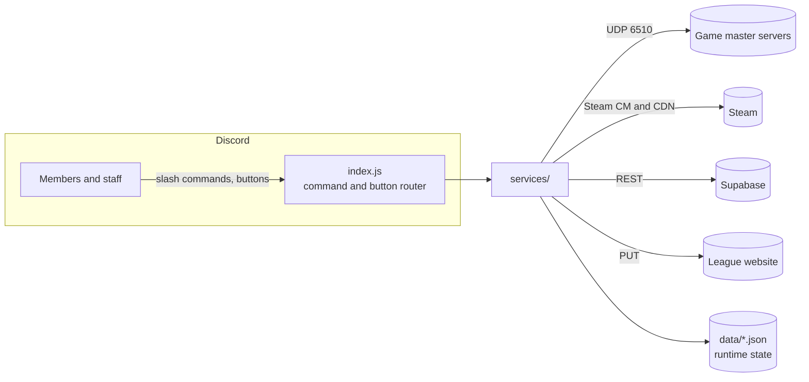

# Yuji Ide: a Discord bot for a sim-racing league community

**Yuji Ide** runs the day-to-day operations of an online racing community built around the game
[Ultimate Racing 2D 2](https://store.steampowered.com/app/1285230/). The community has two Discord
servers, eight leagues and races every week. Admins used to do everything below by hand. The bot
now handles it, and it has been running in production for the whole league season.

Built with **Node.js** and **discord.js v14**. Its core is a reverse-engineered UDP game protocol,
which lets the bot read live races and host game lobbies itself, without running the game.

---

## What it does

| Area | Feature |
|---|---|
| **Race control** | `/report`: incident reports with steward voting, penalty points and a corrected result posted as a reply |
| **League admin** | Weekly *starters* board (`/attend`): sign-ups per team, approval from the team owner, opening and closing times per league, rendered as an image |
| | Driver contracts (`/offercontract`) with automatic role assignment, on two servers |
| | Anonymous weekly attendance check, run on the league calendar so it skips break weeks |
| **Live races** | Live list of online game lobbies, updated from the game's master servers |
| | `/results listen`: joins a lobby *invisibly* and posts the qualifying and race classification as CSV |
| | **HTML race replays**: a self-contained page with a TV-style timing tower, onboard camera, minimap, weather and pit stops, and best-lap ordering with sector times for qualifying |
| | `/upload replay`: publishes a replay on the league website |
| **Practice** | Daily practice lobbies **hosted by the bot itself**: track, laps and weather from the league calendar, then qualifying and races back to back |
| **Data** | `/results upload`: imports results into a Supabase (PostgreSQL) database, with a preview and manual matching for unknown drivers |
| | `/record`: top lap times from the game's Steam leaderboards |
| **Community** | Steam news posts and store sales announced automatically, plus a player count in the bot's status |
| | `/message`: staff post messages as the bot; anyone with the same roles can edit them later (right click → Apps), with every edit logged |

---

## Engineering highlights

### Reverse-engineering the game's network protocol
The game has no public API. I worked out its lobby protocol from packet captures, using small Node
scripts that parse `.pcapng` files directly:

- **Transport**: UDP to a master server. Fields are null-terminated, and reliable messages use
  sequence numbers, ACKs and resends.
- **Lobby lifecycle**: messages for register, join, roster, settings, session start, lap reports,
  results and close.

With that, the bot can:
- **Listen** to a lobby as a hidden client, which takes no seat and is invisible to players
  ([`resultsWatcher.js`](services/results/resultsWatcher.js)).
- **Host** a lobby headlessly as a spectator
  ([`lobbyHost.js`](services/mocks/lobbyHost.js)). It sends the roster, grid, settings and result
  tables the game expects, and decides when sessions end from the lap reports the players' games
  send.

Finding out what each field means took real investigation. One example: the bot only gave a car
to the first driver. Comparing captures from a real host and from the bot showed that a settings
field, previously thought to be the round number, is the number of drivers racing.

### Race replays from network traffic
[`services/replay/`](services/replay/) turns roughly 60 position packets per second and per car
into a replay you can scrub through:

- **Clock sync**: each car's frame counter is aligned to one race clock with a rolling median,
  which filters out network jitter.
- **Race progress**: every car is projected onto a reference lap to get distance raced. That gives
  the running order, the gaps, the finish order (F1 rules, including lapped cars) and sector times.
- **Track identification**: the bot fits each candidate track's minimap to where the cars actually
  drove. It checks both that the points land on the track and that they cover all of it. This
  matters because the lobby's own track list can be wrong.
- **Single-file output**: positions are delta-encoded and deflated (about 9x smaller), and the page
  decompresses them in the browser with `DecompressionStream`. Track and car images are embedded,
  so the replay is one HTML file that works offline.

### Getting game assets straight from Steam
Track and car images come from Steam, downloaded with the bot's own Steam session
([`assets.js`](services/replay/assets.js)):

- **Content downloads**: the bot fetches the game's depot and Workshop manifests and downloads their
  chunks. It decrypts them and decompresses LZMA, Zstandard or zip. My own decoder handles the
  chunk formats, so it doesn't depend on a library that breaks on newer Node versions.
- **Built-in cars**: these sprites live only inside the game's GameMaker data file. A small parser
  ([`gamemaker.js`](services/replay/gamemaker.js)) reads its chunks and decodes the QOI and PNG
  texture pages.
- **Caching**: results are cached, and a cut-off download is detected and fetched again.

### Reliability
- **No double work after a restart**: every scheduled job (starters, attendance checks, practice
  lobbies, weekly round changes) can run more than once without repeating itself. State lives in
  small JSON stores, so a restart never posts or opens anything twice.
- **Calendar logic**: weekly windows, break weeks, seasons split in halves, and opening and closing
  times per league all come from one calendar module
  ([`starterCalendar.js`](services/starters/starterCalendar.js)).
- **Config stays hand-editable**: the bot updates `config.json` in place with text edits instead of
  rewriting the whole file, so the admins' layout survives.

---

## Architecture



```
index.js            Loads commands, starts every service, routes buttons and menus
config.example.json Server-specific settings (channels, roles, leagues, schedules): copy to config.json
commands/           One file per slash command, loaded automatically
services/
  core/             Button router, cleanup, presence, Supabase client
  reports/          Race reports and steward votes
  contracts/        Driver contracts
  starters/         Weekly starters board and league calendar
  racecheck/        Anonymous weekly attendance check
  results/          Lobby listener (live results) and results import
  replay/           recorder -> builder -> assets (Steam) -> render (HTML)
  mocks/            Bot-hosted practice lobbies (headless game host)
  steam/            Lobby list, news and sales, leaderboards, profiles
assets/replay/      Replay page template
scripts/            One-off tools (Steam login)
```

---

## Running it

Requires **Node.js 20+**.

```bash
npm install
cp .env.example .env    # then fill it in
npm start
```

| Variable | Used for |
|---|---|
| `DISCORD_TOKEN`, `CLIENT_ID`, `GUILD_ID` | Bot login and slash command registration |
| `STEAM_REFRESH_TOKEN` | Leaderboards and replay assets. Create it with `npm run steam-login` |
| `SUPABASE_URL`, `SUPABASE_SERVICE_KEY` | Results import |
| `REPLAYS_UPLOAD_KEY` | Publishing replays to the league website |

Everything specific to the community (channel and role IDs, leagues, schedules) lives in
`config.json`, which is not in the repository: copy [`config.example.json`](config.example.json)
(same layout, IDs blanked out) and fill it in.

## Security notes

- **Secrets**: only in `.env`, which is git-ignored. The Steam login script stores a refresh token,
  never the password. The Supabase service key is only used on the server.
- **Lobby passwords**: the game's lobby list includes them in plain text. The bot only records
  *whether* a lobby has one, and never stores or shows the password itself.
- **Hidden listening** is read-only: the bot never sends gameplay data into a lobby it listens to.
- **Dependency audit**: `npm audit` still lists advisories in `steam-user`'s dependencies
  (`protobufjs`, `adm-zip`). The bot only parses data from Steam's own servers, and it unzips in
  memory without writing extracted files to disk.

---

*Community project, built with the knowledge and consent of Applimazing (the developer of Ultimate Racing 2D 2).*

© Marco. All rights reserved: the code is published to show my work. It is not licensed for reuse.
